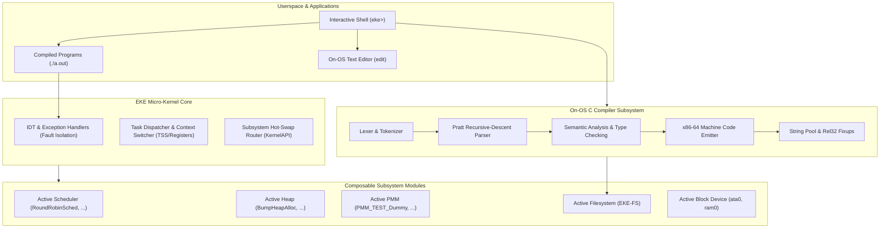

# OSig:EKE (Experimental Kernel Environment)

<p align="center">
  
  
  
  
</p>

```
  ██████╗ ███████╗██╗ ██████╗       ███████╗██╗  ██╗███████╗
 ██╔═══██╗██╔════╝██║██╔════╝       ██╔════╝██║ ██╔╝██╔════╝
 ██║   ██║███████╗██║██║  ███╗█████╗█████╗  █████╔╝ █████╗  
 ██║   ██║╚════██║██║██║   ██║╚════╝██╔══╝  ██╔═██╗ ██╔══╝  
 ╚██████╔╝███████║██║╚██████╔╝      ███████╗██║  ██╗███████╗
  ╚═════╝ ╚══════╝╚═╝ ╚═════╝       ╚══════╝╚═╝  ╚═╝╚══════╝
    Experimental Kernel Environment & Composable OS Lab
```

> **OSig:EKE** is not just another hobby operating system. It is a **composable, bare-metal 64-bit operating system lab** designed to eliminate the friction of operating systems research. 
> 
> Boot cold from bare metal in under 1 second, open an on-OS full-screen text editor, write a custom kernel subsystem or user program in C, compile it directly inside the OS into native x86-64 machine code, and hot-swap it live into the running kernel without rebooting.

---

## ✨ Key Highlights

- **⚡ Zero-Reboot Subsystem Hot-Swapping:** Hot-swap schedulers, memory allocators, physical page managers, and filesystems at runtime via dynamic function-pointer dispatch tables (`gk.sched = new_sched;`).
- **📝 On-OS Full-Screen Text Editor (`edit`):** An 80×25 VGA interactive editor with line numbers, cursor navigation, multi-line editing, backspace line-merging, and disk persistence.
- **⚙️ Built-In Freestanding C Compiler (`compile`):** A custom on-OS C compiler featuring a Pratt recursive-descent parser, semantic type checker, and direct stack-based x86-64 machine code emitter with a custom 64-byte `DiskModuleHeader`.
- **🛡️ True Process Fault Isolation:** Programs execute as independent preemptible child tasks (`PID 2, 3...`) with individual stacks and exit trampolines. If user code crashes (`#DE` divide-by-zero, `#PF` page fault), the kernel terminates only the faulting process — the shell and kernel remain 100% alive.
- **💾 Custom Filesystem & Multi-Drive Manager (`eke_fs`):** Block-level storage engine supporting IDE ATA disks (`ata0`) and RAM disks (`ram0`), backed by an SPMM (Sector Physical Memory Manager) allocation bitmap.
- **⌨️ Interactive Shell with History:** Built-in shell supporting <kbd>↑</kbd> and <kbd>↓</kbd> command history, pipe-less syntax, binary execution (`./a.out`), and live kernel diagnostics.

---

## 🎬 The Complete Self-Hosting Workflow

Everything happens live inside **OSig:EKE** on bare metal:

```
+---------------------------------------------------------------------------------+
|                                1. WRITE CODE                                    |
|   eke> edit my_sched.c                                                          |
|   (Write a Round-Robin or Priority Scheduler in the on-OS VGA text editor)      |
|   Press ^S to Save to disk, ^Q to Exit                                          |
+---------------------------------------------------------------------------------+
                                       |
                                       v
+---------------------------------------------------------------------------------+
|                                2. COMPILE ON-OS                                 |
|   eke> compile my_sched.c my_sched.mod                                          |
|   [COMPILER] Lexing -> Parsing AST -> Semantic Analysis -> Emitting x86-64     |
|   [COMPILER] Success! Wrote 186 bytes to 'my_sched.mod'.                        |
+---------------------------------------------------------------------------------+
                                       |
                                       v
+---------------------------------------------------------------------------------+
|                         3. EXECUTE OR HOT-SWAP LIVE                             |
|                                                                                 |
|   Option A: Run as Isolated Process                                             |
|   eke> ./my_sched.mod                                                           |
|   [EXEC] Spawning child task (PID 2)... Process returned: 42                    |
|                                                                                 |
|   Option B: Hot-Swap into Kernel Brain                                          |
|   eke> makemod my_sched.c sched my_sched                                        |
|   eke> load my_sched                                                            |
|   [SWAP] Switched active Scheduler to: my_sched (2 tasks migrated)              |
+---------------------------------------------------------------------------------+
```

---

## 🏛️ System Architecture



---

## 📁 Repository Structure

```
.
├── boot/
│   └── boot.s                 # 32-bit Multiboot entry, 4-level paging setup, long mode jump
├── kernel/
│   ├── kernel.cpp             # Kernel entry point (kernel_main) & module discovery
│   ├── kernel_api.h           # Core Kernel & KernelAPI function pointer contracts
│   ├── module_api.h           # Dynamic subsystem interfaces (SCHED, HEAP, PMM, FS, DISK)
│   ├── module_swap.cpp        # Live runtime subsystem hot-swapping logic
│   ├── task.cpp               # Multitasking, process control blocks, task exit trampolines
│   ├── shell.cpp              # Interactive CLI shell, command table, history buffer
│   ├── tty.cpp                # 80x25 VGA text buffer driver & serial COM1 output
│   └── linker.ld              # Bare-metal linker script (1MB load address)
├── compiler/
│   ├── compiler.c             # High-level compile driver (compile_file, compile_c_code)
│   ├── lexer.c                # C tokenizer and token stream generator
│   ├── parser.c               # Recursive-descent & Pratt expression AST parser
│   ├── sema.c                 # Semantic analysis, type verification, symbol resolution
│   ├── codegen_x86.c          # Raw x86-64 machine code generator & string pool manager
│   └── compiler_compat.c      # Freestanding runtime, 512KB arena allocator, setjmp/longjmp
├── editor/
│   ├── editor.cpp             # Full-screen interactive VGA text editor
│   └── editor.h               # Editor public API (editor_open)
├── storage/
│   ├── spmm.cpp               # Sector Physical Memory Manager (block bitmap allocator)
│   └── spmm.h                 # Storage allocation interfaces
├── modules/
│   ├── sched/
│   │   └── round_robin.cpp    # Round-Robin preemptive scheduler module
│   ├── heap/
│   │   └── bump_alloc.cpp     # Bump heap allocator module
│   ├── pmm/
│   │   ├── custom_pmm.cpp     # Dynamic PMM test module 1
│   │   └── custom_pmm2.cpp    # Dynamic PMM test module 2
│   ├── fs/
│   │   └── eke_fs.cpp         # Custom contiguous block filesystem module
│   └── disk/
│       ├── ata.cpp            # PIO-mode IDE ATA disk driver (ata0)
│       └── ramdisk.cpp        # 16 MB memory-backed block device (ram0)
├── interrupts/
│   ├── idt.cpp                # IDT setup, PIC remapping, CPU exception fault isolation
│   └── idt_asm.s              # Raw ISR stubs, common handler, context save/restore
└── Makefile                   # Build pipeline and QEMU virtual machine runner
```

---

## 💻 Available Shell Commands

| Command | Syntax | Description |
|---|---|---|
| `help` | `help` | Lists all registered commands and descriptions |
| `edit` | `edit <filename>` | Launches the full-screen VGA on-OS text editor |
| `compile` | `compile <source.c> [out.mod]` | Compiles a C source file into raw x86-64 machine code |
| `run` / `./` | `./<binary>` or `run <binary>` | Executes a compiled program in an isolated child task |
| `makemod` | `makemod <src.c\|bin> <type> [name]` | Builds and registers a module into the kernel registry |
| `load` | `load <module_name>` | Hot-swaps an active kernel subsystem at runtime |
| `mods` | `mods` | Displays all registered modules categorized by subsystem |
| `disks` | `disks` | Lists all detected storage devices and active drive |
| `drive` | `drive <disk_name>` | Switches the active storage drive (e.g. `drive ram0`) |
| `ls` | `ls` | Lists all files and sizes on the active filesystem |
| `cat` | `cat <filename>` | Prints file contents directly to the terminal |
| `write` | `write <filename> <text>` | Writes text directly to a file on disk |
| `rm` | `rm <filename>` | Deletes a file from the active drive |
| `clear` | `clear` | Clears terminal screen and resets scrollback |
| `mem` | `mem` | Displays current active heap allocation count |
| `echo` | `echo <text>` | Prints text to terminal output |

---

## 🚀 Building & Running

### Prerequisites

To build and run **OSig:EKE**, ensure you have a standard 64-bit cross-toolchain or native Linux build environment:

```bash
# On Ubuntu / Debian / Pop!_OS:
sudo apt update
sudo apt install build-essential qemu-system-x86 nasm
```

### 1. Build the Kernel

```bash
git clone https://github.com/Pnatehc13/EKE.git
cd EKE
make clean
make
```

### 2. Boot in QEMU

```bash
make run
```
*EKE boots directly into pure 64-bit Long Mode in **< 1 second**.*

### 3. Exit QEMU
- In terminal mode: Press `Ctrl+A` then `X`.
- In windowed mode: Close the QEMU window.

---

## 🧪 Quick Test Drive Inside EKE

Once the shell boots (`eke> `), try this complete demonstration:

```bash
# 1. Open the on-OS editor and write a program
edit hello.c
```
Type your code inside the editor:
```c
int main() {
    int a;
    int b;
    a = 100;
    b = 23;
    printf("Computed inside EKE: %d\n", a + b);
    return a + b;
}
```
- Press <kbd>Ctrl+S</kbd> to save.
- Press <kbd>Ctrl+Q</kbd> to return to the shell.

```bash
# 2. Compile the C code directly inside the OS
compile hello.c hello.out

# 3. Execute the program as an isolated child task
./hello.out
```

Output:
```
[EXEC] Spawning child task for 'hello.out'...
[EXEC] Process PID 2 running in foreground...
Computed inside EKE: 123
[EXEC] Process PID 2 returned: 123
eke> 
```

---

## 🔮 Roadmap

- [x] 64-bit Long Mode Kernel with 4-level Paging
- [x] Subsystem Hot-Swapping (`SCHED`, `HEAP`, `PMM`, `FS`, `BLOCKDEV`)
- [x] Contiguous Block Filesystem (`eke_fs`) on IDE ATA and RAMDisk
- [x] On-OS Interactive Full-Screen Editor (`edit`)
- [x] On-OS C Compiler generating native x86-64 machine code
- [x] Process Fault Isolation (Crash immunity for kernel and shell)
- [ ] **Background Tasks (`&`) & Load Generator:** Spawn concurrent dummy worker processes to benchmark schedulers live
- [ ] **Linux ABI Compatibility Layer:** Hooking the `syscall` MSR (`LSTAR`) to run unmodified static Linux CLI binaries
- [ ] **Dynamic Kernel Heap Expansion:** Auto-growing virtual heap pages beyond the initial 4KB boundary

---

## 📜 License

Distributed under the MIT License. See `LICENSE` for more information.

---

<p align="center">
  <b>Built from bare metal with pure silicon passion.</b><br>
  <i>OSig:EKE — The Composable Operating System Lab</i>
</p>
